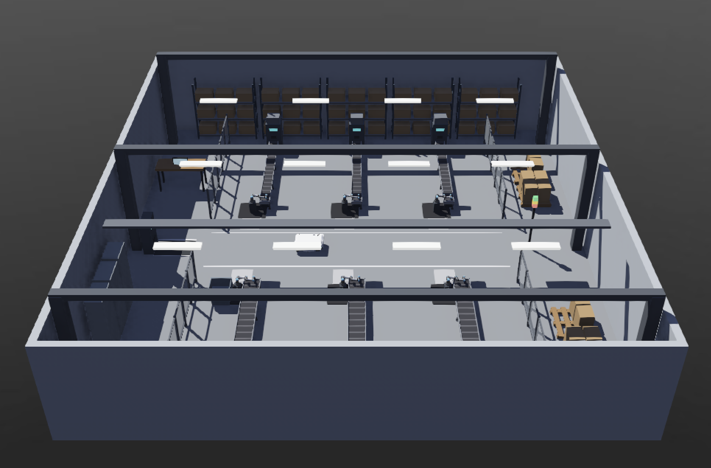

# Fundamentals of Robotics - semester project

A warehouse **order-preparation** simulation in Webots R2025a with MiR100 transport robots and UR3e arms. You build the
controllers step by step over four assignments and a final project.

Start here:

1. `docs/01_setup_guide.md` - install and run
2. `docs/02_world_and_task.md` - what the world is and what you have to do in it
3. `docs/03_interface_reference.md` - devices, messages, files
4. `docs/04_rules_and_grading.md` - rules, metrics, how your work is graded
5. `docs/assignment_N.md` - the current assignment

Open `worlds/warehouse.wbt` in Webots, press Play. Edit only `controllers/student_*/`.
