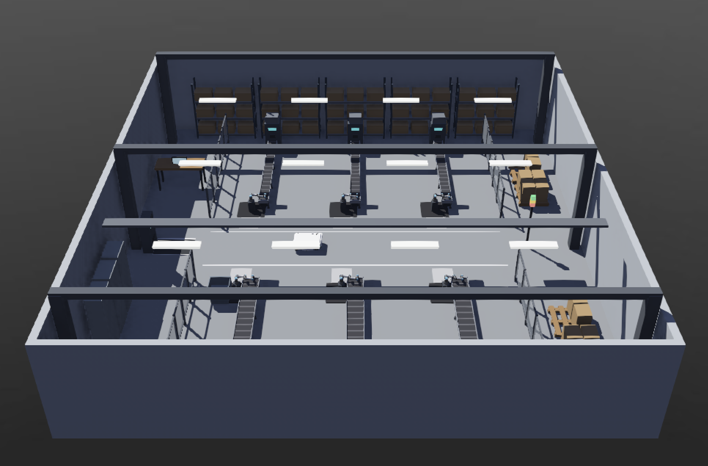
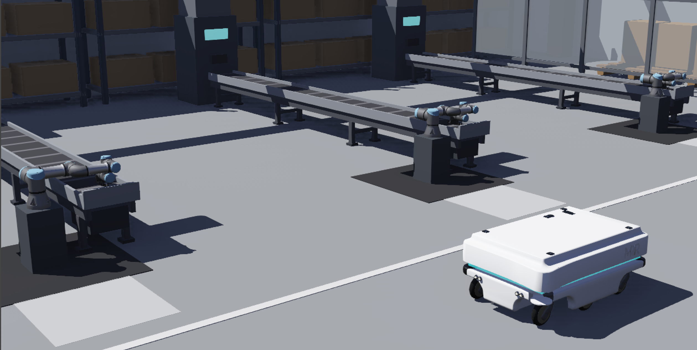
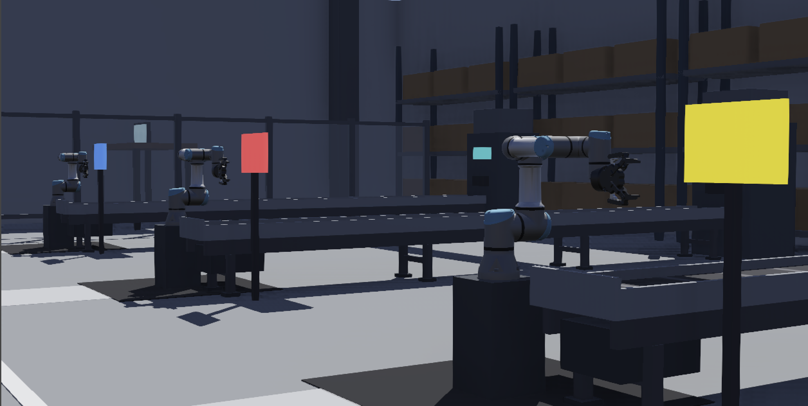

# 02 - The world and the task

## The scenario: order preparation

A small automated warehouse prepares customer orders from colored blocks.

* **Three input belts** (north side), each carrying blocks of **one color**. Blocks arrive endlessly at the belt start.
  A belt stops when a block reaches its end (within reach of the input arm) and starts again when the block is lifted.
* **Orders** arrive over time. An order is a list such as "3 blue, 2 red, 1 yellow".
* For each order an empty **order tote** appears on one of the three **output belts** (south side), under that lane's
  output arm.
* **MiR100 robots** carry blocks from the input arms to the output arms. An input arm puts a block on the MiR, the MiR
  drives to the right output arm, the output arm puts it into the tote.
* When a tote holds all the ordered blocks, the order is **complete**: the tote rides down the output belt and leaves,
  and the lane is free for the next order.
* Robots have a **battery** and there is one **charging station**.
* There is a **reject bin** only the leftmost output arm can reach, for wrong or unwanted blocks.

You are rated on how many orders you finish, how fast, and how cleanly (see `04_rules_and_grading.md`).



*Three input stations (top, with the shelves behind) and three output stations (bottom). The MiR100 drives in the aisle between them.*





## Coordinates

World frame: **x east, y north, z up**, in metres. Angles are radians, counter-clockwise seen from above, 0 = +x.
The default camera looks north from the south wall, so +x is to the right.

```
 y= 6 +--------------------------------------------------------------+
      |  [dispenser]       [dispenser]       [dispenser]              |
      |   input_0 (blue)    input_1 (red)     input_2 (yellow)        |   belts flow south
 y= 2 |  [arm]=|            [arm]=|            [arm]=|   arm picks the block at the belt end
      |  [dock]              [dock]             [dock]                |
      |                aisle (MiR drives here)                        |
 [CHG]|                                                               |   CHG = charging pad (x=-5.6)
      |  [dock]              [dock]             [dock]                |
 y=-2 .25 [arm]=[tote]       [arm]=[tote]       [arm]=[tote]          |   arm drops blocks into the tote
      |[reject bin]  output_0    output_1          output_2           |   belts flow south
 y=-6 +--------------------------------------------------------------+
        x=-3                x=0               x=3
```

All numbers are in `config/layout.json`. The important ones:

| Item | Value |
|---|---|
| Belt columns | x = -3, 0, 3 (index 0, 1, 2) |
| Input belts | y from 6 to 2, flow south, 0.30 m wide; blocks stop at y = 2.045 |
| Output belts | y from -2 to -6, flow south, 0.45 m wide |
| Arms | UR3e on a pedestal 0.40 m west of each belt; input arms at y = 2.045, output arms at y = -2.25 |
| Tote | 0.40 x 0.40 x 0.10 m open box on the output belt under the output arm |
| Block | 5 cm cube, 0.1 kg |
| MiR100 start pose | (-1.5, 0), heading 0 (`mir_start` in layout.json) |

### Stations (MiR parking poses)

`layout.json -> stations` gives `[x, y, heading]` for seven stations:

| Name | Meaning | Heading |
|---|---|---|
| `input_0..2` | next to the input arm of belt i, the MiR deck is within reach of the arm | north (pi/2) |
| `output_0..2` | next to the output arm of lane i | south (-pi/2) |
| `charger` | charging pad at the west wall | west (pi) |

The heading is the direction the robot's front points when parked. White floor markers show the docks.

A robot is counted as **docked** at a station when, for 1.0 s in a row, its center is within **0.15 m** of the station
position, its heading is within **0.20 rad** of the station heading, and its speed is below **0.03 m/s**.
Every dock is logged with its position and heading error.

## Orders and totes

Orders come from the config (fixed list, random generator, or both). When an order is released and a lane is free
(round-robin), the tote is created on that lane and the order is broadcast (see `03_interface_reference.md`). If all
lanes are busy the order waits in a queue, and that waiting time is measured.

An order is complete as soon as the tote contains **at least** the ordered number of every color. Extra or wrong blocks in
the tote at that moment count as `extra_items`. An order is **late** if it took longer than `time_limit_s` from the moment
its tote appeared. Blocks that fall on the floor are `dropped` (removed after a few seconds). Blocks put in the reject
bin are `rejected`.

## Battery

Each MiR100 starts with the preset's `start_level` percent. It drains with time, distance driven and turning, and charges
at 1 %/s while stopped within 0.30 m of the charger pad center. At 0 % the robot is stopped by the simulator; after 30 s it
is towed to the charger with 10 % and a *rescue* is recorded (a penalty in later assignments). The level is broadcast to
the robot through its `customData` (see the interface reference).

## Configuration and presets

`config/world_config.json` names a **preset** and may override any key:

```json
{ "preset": "a1", "run": { "duration_s": 360 } }
```

| Preset | Used in | What is active |
|---|---|---|
| `a1` | Assignment 1 | no blocks, no orders, mission route, battery starts at 60 % |
| `a2` | Assignment 2 | no blocks, no orders, long mission route (20 stops), realistic sensor noise, battery starts at 100 % |
| `a3` | Assignment 3 | blocks on, one small order, battery off |
| `a4` | Assignment 4 | full task: 2 fixed + 8 random orders, battery on |
| `final` | Final project | full task, more orders, longer run |

Main keys: `seed`, `run.duration_s` (null = never stops), `run.on_finish` (`pause` or `quit`), `shipment.input_colors`,
`shipment.spawn`, `shipment.orders`, `shipment.random_orders`, `shipment.time_limit_s`, `battery.*`, `conveyors.*`,
`parking.*`. Read the preset file in `config/presets/` to see every value.

The grader uses its **own hidden configuration** (different seed, orders and, in some assignments, mission details) with
the same structure. Your controller must work from what the simulation tells it at run time, not from numbers you read
from your own config file.

## Run and results

At the end of a run (and every 15 s while running) the manager writes to `results/latest/`:

| File | Content |
|---|---|
| `summary.json` | all metrics (see `04_rules_and_grading.md`) |
| `events.csv` | time-stamped events: order start/complete/shipped, block at pick position/picked/dropped/rejected, dock, charge start/end, battery empty, rescue |
| `timeseries.csv` | once per second: orders, queue, MiR pose, speed and battery |
| `localization_<robot>.csv` | (assignment 2) your reported pose next to the true pose, with the errors; `estimate_<robot>.csv` is your raw report |
| `report.png` | plots (needs matplotlib): orders over time, time per order, battery, MiR path |

You can redraw the plots with `python tools/report.py results/latest`.
